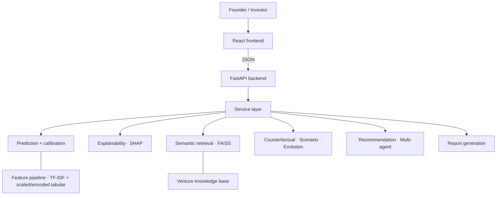
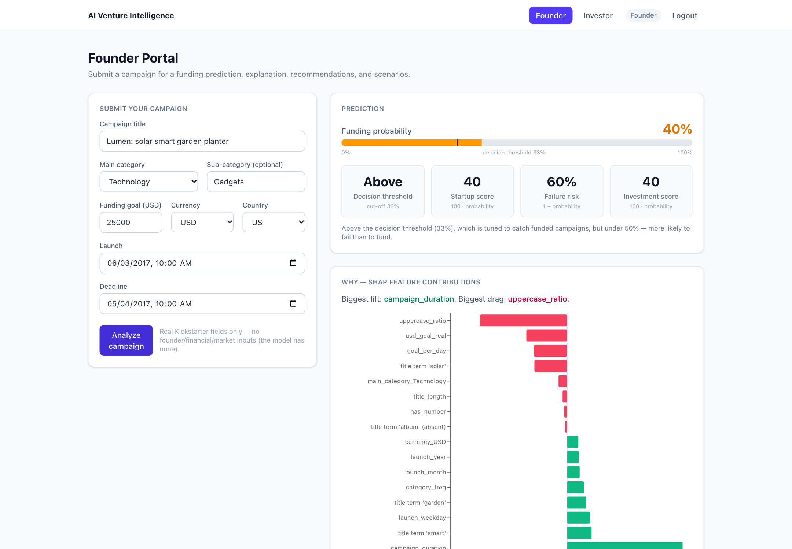
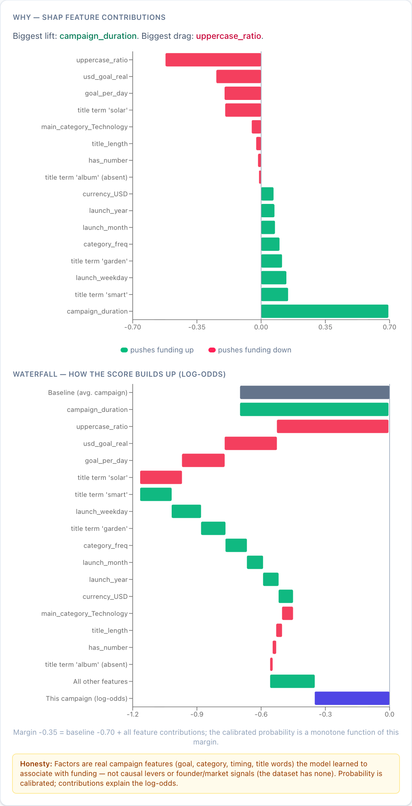
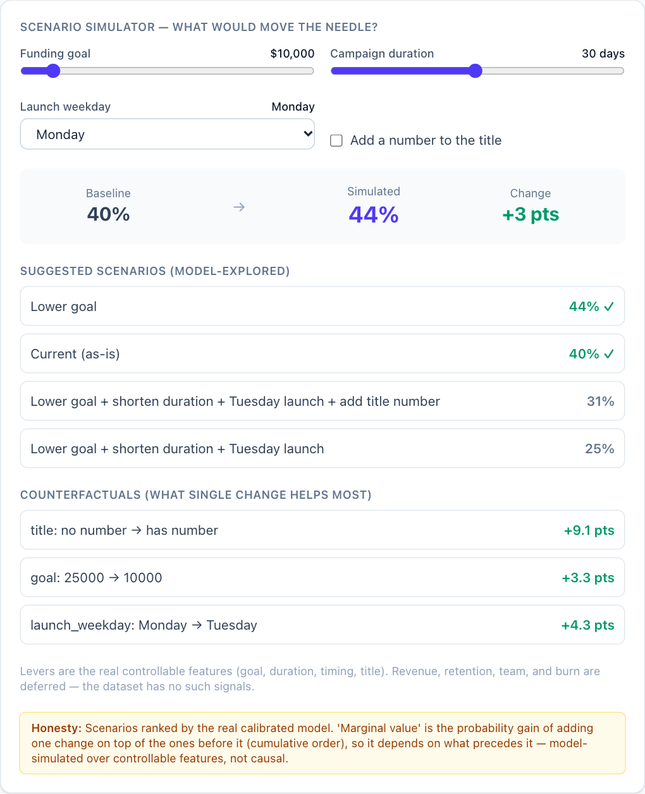
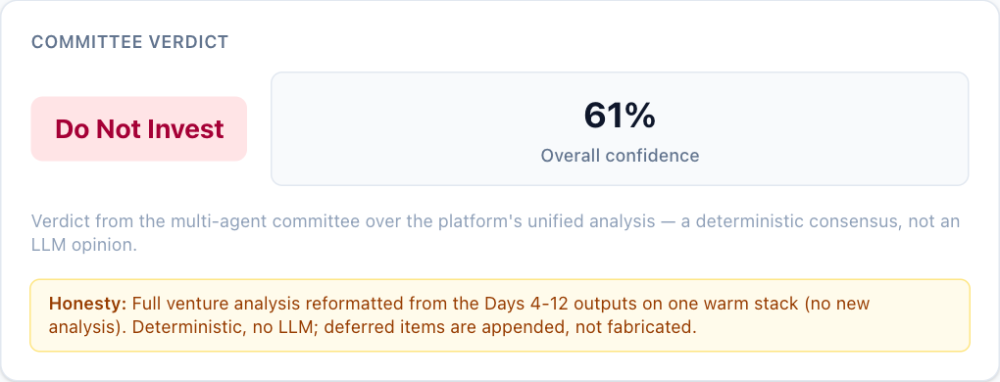

# AI Venture Intelligence Platform

A machine-learning system that analyzes a crowdfunding campaign (Kickstarter) and tells a **founder**
what to fix and an **investor** what to weigh: a calibrated funding probability, the reasons behind it,
similar past campaigns, what-if scenarios, and written reports — served by a FastAPI backend and a
React dashboard.

> **Honest by design.** The data is Kickstarter campaigns: title, category, goal, country, currency,
> dates. It contains **no founder, team, revenue or market data**, so the platform does **not** score
> Business Model, Founder Strength, Scalability, Market Fit or Growth Potential, and it has no market-size
> (TAM / SAM) figure. Those appear in the UI as visible *"deferred — no data basis"* cards, never as
> invented numbers. (A category-level opportunity signal from Kickstarter history *is* computed.)
> See [Limitations](#limitations).

## Motivation

Predicting "will this get funded?" is a classifier. Making that prediction *useful* needs more: why the
model says so, which similar campaigns succeeded or failed, which single change would help most, and
how an investor would push back. This project builds that full chain end to end — from raw CSV to
a deployable product — and keeps every output traceable to real data.

## Features

| | |
|---|---|
| **Prediction** | Calibrated funding probability (tuned LightGBM + sigmoid calibration), decision threshold 0.329 |
| **Explainability** | SHAP local explanations (bar chart + waterfall), coefficient analysis from the LogReg baseline |
| **Semantic retrieval** | SBERT embeddings + FAISS: similar successful / failed campaigns with reasons |
| **Pattern mining** | Association rules (support / confidence / lift) over real features, with significance tests |
| **Counterfactuals & scenarios** | "What single change helps most?" and goal / duration / timing / title what-ifs |
| **Investor objections & evolution** | Rule-based objection simulator, funding-readiness roadmap |
| **Recommendations** | Prioritized improvements, founder and investor strategy, confidence score |
| **Multi-agent analysis** | Six deterministic agents (five specialists plus an investment agent) and a consensus step |
| **Reports** | Founder report, investor report, memo, executive summary (JSON / Markdown / HTML) |
| **Product** | FastAPI backend, React + TypeScript Founder and Investor portals |
| **Engineering** | MLflow tracking, model registry, 95 tests, CI (fast lane), Docker config |

## Architecture



The platform is **one process**: 13 layers loaded once as a warm stack, FAISS in-process. Details:
[docs/SYSTEM_ARCHITECTURE.md](docs/SYSTEM_ARCHITECTURE.md) and
[docs/PROJECT_OVERVIEW.md](docs/PROJECT_OVERVIEW.md).

## Quick start

Requires Python 3.14. Full steps and troubleshooting: [docs/INSTALLATION.md](docs/INSTALLATION.md).

```bash
python3.14 -m venv .venv && source .venv/bin/activate
pip install -r requirements.txt
python scripts/download_nltk_data.py
# place data/raw/ks-projects-201801.csv and the trained artifacts (see Installation)

OMP_NUM_THREADS=1 CORS_ORIGINS=http://localhost:5173 uvicorn src.api.main:app --port 8000
cd frontend && npm install && npm run dev      # http://localhost:5173
```

## Dataset

The public Kaggle dataset "Kickstarter Projects" (`ks-projects-201801.csv`, 378,661 campaigns). The CSV
is **not redistributed** in this repository — search for it on Kaggle, download it and place it at
`data/raw/ks-projects-201801.csv`. Leakage columns (pledged amounts, backers) are excluded; the target
is `successful = 1`, `failed = 0`.

## ML pipeline

Cleaning → validation → business-integrity rules → text normalization + **TF-IDF (800 features)** →
`StandardScaler` / `OneHotEncoder` → sparse–dense fusion with `scipy.sparse.hstack` → feature
selection → model benchmark → hyperparameter search → probability calibration → serialization.

## AI pipeline

Prediction → SHAP explanation → SBERT/FAISS retrieval → pattern mining → counterfactuals → objections →
evolution roadmap → scenarios → recommendations → multi-agent consensus → reports. Every layer reads
the same calibrated probability and the same real features.

## API usage

```bash
curl -s -X POST localhost:8000/predict -H 'Content-Type: application/json' -d '{
  "name": "EcoTrack smart garden", "main_category": "Technology", "category": "Gadgets",
  "currency": "USD", "country": "US", "usd_goal_real": 25000,
  "launched": "2024-03-04 10:00:00", "deadline": "2024-04-03 10:00:00"}'
```

| Endpoint | Purpose |
|---|---|
| `POST /predict` · `/explain` | probability, label, threshold · SHAP drivers |
| `POST /retrieve?k=` | similar successful / failed campaigns |
| `POST /counterfactual` · `/scenario` | single-change lift · what-if scenarios |
| `POST /recommend` | readiness, priority improvements, strategy |
| `POST /analyze` | committee verdict, objections, four reports |
| `POST /report/founder` · `/report/investor` | sectioned reports with provenance |
| `GET /health` · `/live` · `/ready` | diagnostics and probes |

The request accepts **only** the Kickstarter fields above (`extra="forbid"`); anything else is a `422`.
Interactive docs at `/docs`. Full reference: [docs/API_DOCUMENTATION.md](docs/API_DOCUMENTATION.md).

## Screenshots

Captured from the running app with a fictional demo campaign (full set in [docs/assets/](docs/assets/README.md)).

<p align="center"></p>

| SHAP bar chart and waterfall | Scenario simulator | Committee verdict |
|---|---|---|
|  |  |  |

## Deployment

A single-container Docker setup (multi-stage image, artifacts mounted read-only) with Compose,
health probes and an nginx option is in [deployment/](deployment/). It is **authored but has not been
built** — the development machine has no Docker. See [docs/DEPLOYMENT.md](docs/DEPLOYMENT.md).

## Results

Held-out test set (66,293 campaigns, scored once), deployed model:

| Metric | Value |
|---|---|
| ROC-AUC | 0.7763 |
| PR-AUC | 0.6883 |
| F1 / recall / precision | 0.6664 / 0.8131 / 0.5646 |
| Brier score (calibrated) | 0.1873 |
| Decision threshold | 0.329 |

On the validation set the baseline Logistic Regression (L2) scored PR-AUC 0.6264 and ROC-AUC 0.7269, against
0.6884 and 0.7767 for the deployed model. LightGBM, XGBoost and HistGradient Boosting are within 0.005 PR-AUC
of each other. Full comparison and plots:
[docs/PERFORMANCE_REPORT.md](docs/PERFORMANCE_REPORT.md) (full report, including weaknesses) and `artifacts/evaluations/`.

**95 tests** pass locally (53 fast + 42 heavy). CI runs the fast lane only.

## Limitations

- **Modest ceiling.** ROC-AUC ≈ 0.78: a campaign's pre-launch fields only partly determine its outcome.
- **Data ends in 2017, and the evaluation split is random, not chronological.** Scores describe how a
  campaign would have fared under 2009–2017 conditions and are likely optimistic for new campaigns
  ([Performance Report §12](docs/PERFORMANCE_REPORT.md#12-weaknesses-and-limits)).
- **No founder / team / revenue / market data**, so five scores and market size are deferred (above). Market timing is a
  *category-trend signal from Kickstarter history*, not external market data.
- Factors are **associations, not causes**. Counterfactuals describe the model, not the world.
- CI covers the fast lane; Docker is configured but unbuilt; the UI has no real authentication
  (login is an auth-ready stub).

## Future work

Real founder / market / revenue data (unlocks the deferred scores), temporal forecasting, knowledge
graphs, and more — proposed in [docs/RESEARCH_ROADMAP.md](docs/RESEARCH_ROADMAP.md) (every item is labelled proposed, not built).

## Repository layout

`src/` platform code (13 layers + `api/`, `services/`, `mlops/`) · `frontend/` React app · `notebooks/`
executed daily verification notebooks · `tests/` · `docs/` · `deployment/` · `scripts/` · `artifacts/`
trained objects · `configs/`.

## Author

Built by [yashraj-a11y](https://github.com/yashraj-a11y/) · [LinkedIn](https://www.linkedin.com/in/yash-raj-a54a67323/)

## License

[MIT](LICENSE) © 2026 yashraj-a11y. The Kickstarter dataset is subject to its own terms.
