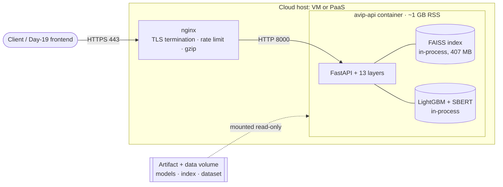

# Day 18 · Phase H — Cloud Deployment Blueprint

*A **blueprint**, not a live deployment. It describes how to run the AI Venture Intelligence Platform
on cloud infrastructure, grounded in the platform's real shape: one process, FAISS in-process, ~1 GB
RSS per container, a multi-GB image, and 400 MB+ of trained artifacts that live outside the image.*

> **Status: not deployed.** Docker isn't available in the authoring environment (Day-18 C-1), so nothing
> here has been provisioned or billed. These are the decisions and tradeoffs to make when you deploy.

---

## 1. Topology

The whole platform is **one container** (FAISS is a library, not a service — Phase A). nginx fronts it
for TLS + rate limiting. The trained artifacts are **mounted read-only**, not baked into the image.
MLflow is *not* in the serving path — it's a training-time local sqlite store, optionally viewed via a
dev-only `mlflow ui` container.

---

## 2. The artifact problem in the cloud (the decision that matters most)

The image holds **code**; the trained artifacts (models 21 MB, **FAISS index 407 MB**, embeddings
407 MB, `metadata.csv` 73 MB) are git-ignored and ~900 MB total. Three honest options:

| Option | How | Pros | Cons |
|---|---|---|---|
| **Volume mount** (recommended for VMs) | attach block storage (EBS / Azure Disk / GCP PD), mount `artifacts/`+`data/` read-only | small image; swap artifacts without rebuild | needs a host with attachable storage (not most PaaS) |
| **Bake into image** (`COPY`) | add artifacts to the build context | self-contained; works on any PaaS | **multi-GB image**; rebuild to update; may exceed size caps |
| **Object storage** (S3 / GCS / Blob) | download to a volume at container start | decoupled, versioned artifacts | cold-start download (~900 MB); needs credentials |

**Rule of thumb:** a VM → volume mount; a size-tolerant PaaS → bake in; many replicas / frequent
updates → object storage with a startup sync.

---

## 3. Cloud platform options (candid)

| Platform | Model | Fit for this platform |
|---|---|---|
| **AWS EC2 / Azure VM / GCP VM** | raw VM | **Best fit.** Full control: attach a data volume, run `docker compose`, front with nginx. Handles the multi-GB image + 900 MB artifacts + ~1 GB RSS cleanly. |
| **Render / Railway** | container PaaS | Works if the **image size** fits their limits and you either bake artifacts in or pull from object storage (no persistent volume for read-only data on all tiers). Watch memory (~1 GB+) and cold starts. |
| **Fly.io** | container + volumes | Good middle ground: supports **mounted volumes** (put artifacts there) and multiple regions; still mind the image size and per-machine RAM. |

**Free tiers frequently won't fit** — a torch+faiss image is multi-GB and the process needs ~1 GB RAM
just warmed. That's a real constraint, not a detail to hide.

---

## 4. Production considerations

- **SSL termination** — at nginx (or the cloud LB). The app speaks plain HTTP on 8000; TLS never
  reaches Python.
- **Reverse proxy** — nginx for TLS, gzip, request-size limits, and **rate limiting** (the app has no
  app-layer limiter — Phase I).
- **Secrets** — **none exist.** The platform is deterministic with no external APIs, so there are no
  keys to manage. `.env` holds only ports/paths/log-level (Phase D). Don't provision a secrets manager
  for secrets you don't have.
- **Auto-restart** — `restart: unless-stopped` (Compose) or the orchestrator's restart policy; the
  `/live` probe distinguishes "up" from "ready" so a warming container isn't killed (Phase F).
- **Horizontal scaling** — **replicas, not workers.** Each worker/container loads the full ~1 GB warm
  stack, so scale by running **N stateless containers behind nginx/an LB**, not `--workers N` in one
  container. The app is stateless (no session/shared state) and the artifacts are read-only, so replicas
  share the same mounted index safely.
- **Health-gated rollout** — route traffic only when `/ready` returns 200; `deploy.sh` already waits on
  it. For zero-downtime, start the new replica, wait for `/ready`, then drain the old one.

---

## 5. What this blueprint deliberately does NOT include (deferred)

Actual provisioning / billing, Kubernetes + Helm, autoscaling policies, a CDN, a managed vector-DB
service (there is none — FAISS is in-process), a remote MLflow tracking server, and a secrets manager
(no secrets). These are named as future work, not pretended-built — consistent with the platform's
honesty discipline.

> **Interview soundbite:** *"My cloud blueprint is honest about the two things that actually decide the
> deployment: the image is multi-gigabyte because of torch and faiss, and there's 900 megabytes of
> trained artifacts that live outside it — so on a VM I mount them as a read-only volume, on a
> size-tolerant PaaS I bake them in, and at scale I pull from object storage at start. The platform is
> one stateless container with FAISS in-process, so I scale horizontally with replicas behind nginx, not
> by adding workers that each reload a gigabyte of models. nginx does TLS and rate limiting, /ready gates
> traffic during the model warm-up, and there's no secrets manager because the platform has no secrets.
> I say plainly that free tiers often won't fit — that's a real constraint, not something to paper over."*
