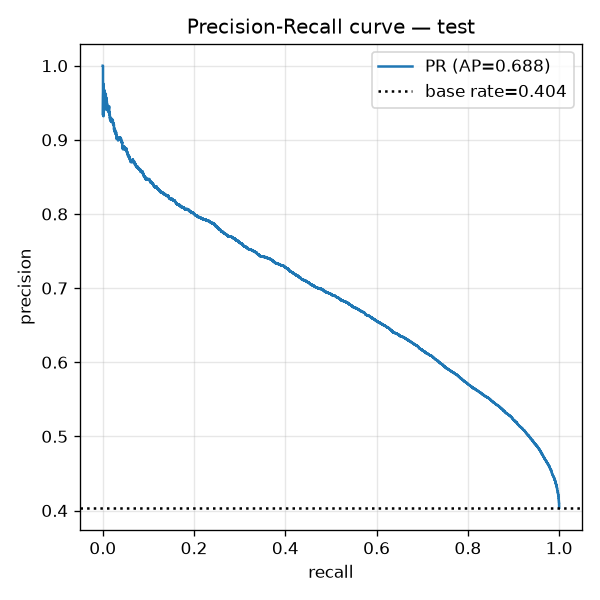
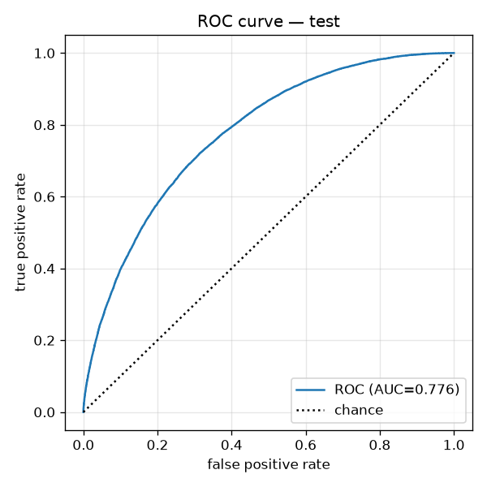
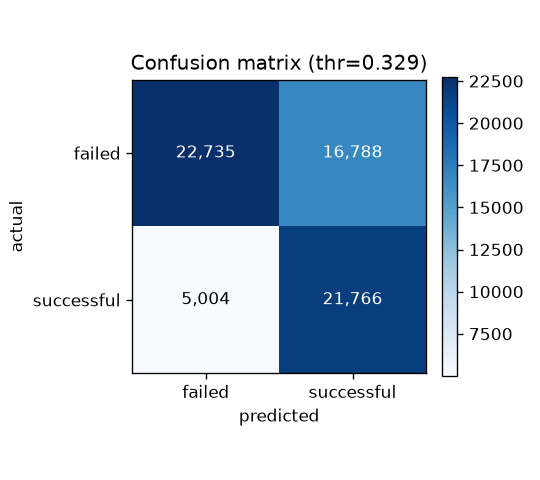

# Performance Report

How well the platform's models and layers perform — measured, quoted from the project's artifacts, and
critiqued. Every number below comes from a file listed in [§13](#13-where-each-number-comes-from); numbers
marked *(derived)* are simple arithmetic on those files. Nothing was re-tuned or re-scored for this report.

## 1. Summary

| | |
|---|---|
| **Task** | Predict whether a Kickstarter campaign reaches its goal, from pre-launch fields only (title, category, goal, country, currency, dates) |
| **Deployed model** | Tuned LightGBM + sigmoid calibration, decision threshold **0.329** |
| **Test set (66,293 campaigns, scored once)** | ROC-AUC **0.7763** · PR-AUC **0.6883** · F1 **0.6664** · recall **0.8131** · precision **0.5646** · accuracy **0.6713** · Brier **0.1873** |
| **Baseline it beats** | Logistic Regression: PR-AUC 0.6264, ROC-AUC 0.7269 (validation) |
| **Chance level** | 40.38% of campaigns succeed, so a model that always says "failed" is 59.6% accurate, and a random ranker has PR-AUC 0.4038 |

**Honest verdict.** The model is real but modest: it ranks campaigns clearly better than chance and
better than the baseline, but a campaign's pre-launch fields only partly determine its outcome, so
roughly one "successful" call in two is wrong at the chosen threshold. The most important caveat is that
the data ends in 2017 and the split is random, not chronological — see [§12](#12-weaknesses-and-limits).

---

## 2. Evaluation protocol

| Item | Value |
|---|---|
| Raw data | 378,661 Kickstarter campaigns, launched 2009-04 to 2017-12 |
| Decided campaigns (`successful` / `failed`) | 331,675 → **331,464** after cleaning |
| Train / test | 265,171 / **66,293**, stratified 80/20 random split, fixed seed |
| Validation | 53,035 rows carved from the *train* portion (model selection and tuning) |
| Features | 865 = 800 title TF-IDF terms + 65 tabular (scaled numeric, one-hot, engineered) |
| Class balance | 40.38% successful |
| Leakage control | Pledged amounts, backers and other outcome columns excluded; feature pipeline and knowledge base fit on **train only** |
| Test discipline | Test set scored **once**, after selection, tuning and calibration were finished on train/validation |

---

## 3. Final model on the held-out test set

Scored once at threshold 0.329.

| Metric | Value |
|---|--:|
| ROC-AUC | 0.7763 |
| PR-AUC (average precision) | 0.6883 |
| F1 | 0.6664 |
| Recall | 0.8131 |
| Precision | 0.5646 |
| Accuracy | 0.6713 |
| Brier score | 0.1873 |

**Confusion matrix** (threshold 0.329)

| | Predicted failed | Predicted successful |
|---|--:|--:|
| **Actually failed** | 22,735 (TN) | 16,788 (FP) |
| **Actually successful** | 5,004 (FN) | 21,766 (TP) |

Derived from the matrix *(derived)*: specificity 0.5752, negative predictive value 0.8196. In plain terms:
the model catches 81% of campaigns that succeed, but flags 42% of the campaigns that fail as successful,
and when it says "failed" it is right 82% of the time.

| Precision–recall (test) | ROC (test) |
|---|---|
|  |  |

### Generalization

| | ROC-AUC | PR-AUC |
|---|--:|--:|
| Train | 0.8167 | 0.7462 |
| Validation | 0.7767 | 0.6884 |
| Test | 0.7763 | 0.6883 |

Validation and test agree to 0.0001 PR-AUC, so model *selection* did not overfit the validation set. The
train–test ROC-AUC gap is 0.0404: a mild amount of overfitting, inside the project's own limit of 0.10.
The Day-17 validation suite checks all of this automatically (7 of 7 checks pass).

---

## 4. Model comparison and selection

Validation set (53,035 rows), ranked by PR-AUC. All candidates use the same fused features.

| Model | Accuracy | Precision | Recall | F1 | ROC-AUC | PR-AUC | Train time |
|---|--:|--:|--:|--:|--:|--:|--:|
| HistGradientBoosting | 0.7067 | 0.6607 | 0.5627 | 0.6077 | 0.7703 | 0.6805 | 30.2 s |
| LightGBM (untuned) | 0.7066 | 0.6608 | 0.5614 | 0.6071 | 0.7697 | 0.6798 | 2.9 s |
| XGBoost | 0.7046 | 0.6599 | 0.5538 | 0.6022 | 0.7675 | 0.6754 | 3.8 s |
| Random Forest | 0.7015 | 0.6676 | 0.5191 | 0.5841 | 0.7592 | 0.6643 | 115.4 s |
| Extra Trees | 0.6982 | 0.6617 | 0.5168 | 0.5803 | 0.7535 | 0.6589 | 186.9 s |
| Logistic Regression (L2) — baseline | 0.6768 | 0.6291 | 0.4864 | 0.5486 | 0.7269 | 0.6264 | 30.2 s |
| Majority-class dummy | 0.5962 | 0.0 | 0.0 | 0.0 | 0.5 | 0.4038 | — |
| **LightGBM, tuned** (deployed, before calibration) | 0.7102 | 0.6635 | 0.5726 | 0.6147 | 0.7759 | **0.6876** | 281 s search |

Accuracy/precision/recall in this table are at the default 0.5 cut; the deployed model uses 0.329 (§6).

**Why LightGBM.** The three gradient-boosting models are within 0.005 PR-AUC of one another, which is
inside what a single split can distinguish, so the choice rested on practical grounds: LightGBM trains in
2.9 s versus 30.2 s for HistGradientBoosting, which made a 75-fit randomized search (`RandomizedSearchCV`, stratified
CV, scored on average precision) cheap. Tuning moved validation PR-AUC from 0.6798 to 0.6876. Random Forest and Extra
Trees were clearly worse and 40–65× slower to train.

**Why a Logistic Regression baseline.** It is the interpretable reference the project's curriculum
required, and it sets the bar: boosting adds **+0.062 PR-AUC** and **+0.050 ROC-AUC** over it. The L1, L2
and ElasticNet variants are indistinguishable (all PR-AUC 0.6264), so regularization type does not matter
here; L2 is the registered baseline (status *Archived*, kept for comparison). The deployed model is the
registry's *Production* entry.

**Neural network: not built.** The roadmap's draft listed one; no network was trained (torch is used only
for SBERT embeddings), and the model-validation artifact records it as deferred. No neural-network
comparison is claimed.

---

## 5. What the model relies on

Mean absolute SHAP over 2,000 rows (uncalibrated LightGBM; additivity error 7.4e-08):

| Rank | Feature | Mean \|SHAP\| |
|--:|---|--:|
| 1 | `usd_goal_real` (funding goal) | 0.320 |
| 2 | `campaign_duration` | 0.263 |
| 3 | `category_freq` (how common the category is) | 0.222 |
| 4 | `launch_year` | 0.201 |
| 5 | `goal_per_day` | 0.150 |
| 6 | `word_count` (title) | 0.134 |
| 7 | `title_length` | 0.111 |
| 8 | `uppercase_ratio` (title) | 0.106 |
| 9 | `launch_weekday` | 0.064 |
| 10 | `launch_month` | 0.059 |

The model leans on **how much money, for how long, in which category, and when** — plus the shape of the
title — rather than on any measure of campaign quality. The 800 individual title words matter far less
individually (the strongest word, `thesis`, is ranked 25th). The Logistic Regression baseline agrees:
its largest coefficient is `category_freq`. These are associations the model learned, not causal levers.

---

## 6. Calibration and the decision threshold

Does a "0.30" really mean about 30%? On validation:

| | Brier | ROC-AUC | PR-AUC |
|---|--:|--:|--:|
| Uncalibrated LightGBM | 0.1875 | 0.7759 | 0.6876 |
| **Sigmoid (deployed)** | **0.1872** | 0.7767 | 0.6884 |
| Isotonic | 0.1872 | 0.7766 | 0.6881 |

Calibration barely changed anything: tuned LightGBM was already close to calibrated, and sigmoid and
isotonic tie. Sigmoid was kept as the simpler method. Against a model that always predicts the base rate
(Brier 0.2407), the deployed model's Brier of 0.1873 is a **22% improvement** *(derived)*. Reliability
plots: [`calibration_curve.png`](../artifacts/evaluations/calibration_curve.png) (validation) and
[`calibration_curve_test.png`](../artifacts/evaluations/calibration_curve_test.png) (test).

**Threshold 0.329 is a choice, not a law.** It maximises F1 (0.6681 on validation, versus 0.6162 at 0.5)
and lifts recall from 0.5762 to 0.8170. That favours *finding* campaigns that will succeed over *avoiding
false alarms*. A use that cares more about precision — an investor screen, say — should raise the
threshold; the cost is more missed successes. The API returns the threshold with every prediction so a
client can apply its own.

---

## 7. Retrieval quality

Semantic search (SBERT `all-MiniLM-L6-v2`, 384-d, exact FAISS index, ~265k train campaigns) is evaluated
with **proxy metrics** on 300 query campaigns, because there is no ground truth for "this campaign is truly
similar", so **Precision@K cannot be measured** and is not claimed.

| Proxy | k=5 | k=10 |
|---|--:|--:|
| Neighbours in the same main category (base rate 10.7%) | 76.6% (7.1× lift) | 75.4% (7.0× lift) |
| Mean reciprocal rank of a same-category hit | 0.854 | 0.857 |
| Mean similarity of rank 1 / rank k | 0.766 / 0.703 | 0.766 / 0.681 |
| Predicting outcome from neighbours: ROC-AUC | 0.685 | 0.712 |
| …accuracy gain over guessing the majority class (within the 300-query sample) | +0.05 | +0.06 |

Retrieval finds topically similar campaigns reliably. It is a **weak predictor of outcome** (ROC-AUC
0.69–0.71, versus 0.78 for the model), which is why it is used as *evidence shown to the founder* and does
not feed the prediction. Day 15's own, larger evaluation reports a similar picture
([`day15_retrieval_reference.md`](day15_retrieval_reference.md)).

---

## 8. Explainability and data checks

| Check | Result |
|---|---|
| SHAP additivity: `base_value + Σ contributions = margin` | error 3.1e-08 (limit 1e-3) — pass |
| Margin reconstructs; positive/negative signs correct | pass |
| Data validation: 11 checks on 331,464 rows | 0 critical failures; 1 warning (4 blank cleaned titles, handled by an empty-string fill) |
| Feature matrix | 265,171 × 865, no NaN or infinity, aligned with labels |

SHAP explains the uncalibrated log-odds margin; calibration is a monotone transform of it, so the ordering
of drivers is unaffected.

---

## 9. Software quality

| | |
|---|---|
| Tests | **95 passed** (53 fast, 42 heavy) in ~5.5 min locally |
| CI | Fast lane only (53 tests) — the heavy tests need git-ignored data, models and the 407 MB index |
| Lint | `ruff` (pyflakes rules): 3 unused-variable warnings left deliberately (removing them could change behaviour) |
| Frontend | `tsc` typecheck + `vite build` pass |

---

## 10. Latency and resources

Measured through the HTTP layer on the development machine (11 CPUs, `OMP_NUM_THREADS=1`), 20 calls each
(5 for `/analyze`), warm:

| Endpoint | p50 | p95 | Budget |
|---|--:|--:|--:|
| `/predict` | 14 ms | 19 ms | 2 s |
| `/explain` | 37 ms | 41 ms | 3 s |
| `/retrieve` | 20 ms | 33 ms | 3 s |
| `/report/founder` | 2.3 s | 2.9 s | 15 s |
| `/analyze` | 3.2 s | 3.3 s | 30 s |

The first `/retrieve` after start takes ~8–12 s (one-time SBERT/torch warm-up). `/recommend` measured
~1.1–1.4 s in the API tests. Memory: the benchmark recorded ~408 MB resident; the fully loaded server
(with the retriever) reported ~1.1 GB on `/health`. These are single-machine, single-user figures — there
is no load test.

---

## 11. Strengths

- **Clean evaluation discipline** — test set scored once; validation ≈ test; leakage columns excluded; fit-on-train-only everywhere.
- **Clear improvement over a strong baseline** — +0.062 PR-AUC over Logistic Regression, and over chance by a wide margin.
- **Probabilities you can read** — calibrated, with Brier 22% better than the base-rate predictor.
- **Explanations that reconcile** — SHAP additivity to 1e-8, checked by an automated test.
- **Fast serving** — prediction and explanation in tens of milliseconds.
- **Every claim is traceable** — metrics, thresholds and checksums are stored with the model.

---

## 12. Weaknesses and limits

1. **The data ends in 2017 and the split is random, not chronological.** `launch_year` is the model's
   4th most important feature, and the success rate moved from ~48% (2009–2013) to 32–43% (2014–2017). A
   random split mixes years, so test scores describe *the same period the model trained on*. A campaign
   launched today has a year the model never saw, and a tree model treats it like the latest year it knows.
   The reported numbers are therefore likely **optimistic for genuinely new campaigns**, and
   `funding_probability` should be read as "how this campaign would have fared in 2009–2017 conditions".
   A time-based split (train on earlier years, test on the last) was not run.
2. **A modest ceiling.** ROC-AUC 0.78 and accuracy 67% (versus 59.6% for always guessing "failed") — a gain
   of about 7.5 accuracy points. Pre-launch metadata only partly determines an outcome.
3. **Precision is low at the chosen threshold.** 16,788 failures are flagged successful for 21,766 correct
   hits; precision is 0.565. High recall was a deliberate choice (§6), but it means a "likely to succeed"
   label is weak evidence by itself.
4. **Model differences among boosted trees are not established.** HistGB, LightGBM and XGBoost differ by
   ≤0.005 PR-AUC from a single split, with no repeated seeds or confidence intervals, so the ranking among
   them is not a statistical finding.
5. **No segment analysis.** Performance was not broken out by category, country, goal size or year, so it
   may be much better or worse for some groups. A single aggregate hides that.
6. **No uncertainty intervals** on any metric.
7. **Calibration is validated only in aggregate** (Brier and reliability plots), not per segment, and
   calibration added almost nothing over the raw model.
8. **Signal is metadata, not quality.** The model sees goal, timing, category and title — not the pitch,
   product, team, video, or marketing. It cannot tell a good campaign from a well-timed mediocre one.
9. **Retrieval is topical, not predictive**, and its quality is measured only by proxies (no Precision@K).
10. **Not built:** a neural network, a time-aware evaluation, per-segment evaluation, a load test, and a
    measured Docker image.

---

## 13. Where each number comes from

| Section | Source |
|---|---|
| §3 test metrics, confusion matrix, train metrics | `artifacts/testing/model_validation.json`, [`day4_model_report.md`](day4_model_report.md) |
| §4 comparison, tuning | `artifacts/evaluations/benchmark.json`, `artifacts/models/best_config.json`, `artifacts/models/logreg_results.json`, [`day4_benchmark_report.md`](day4_benchmark_report.md) |
| §4 deployed model, registry status | `artifacts/models/model_metadata.json`, `artifacts/registry/model_registry.json` |
| §5 feature importance | [`day5_global_importance_report.md`](day5_global_importance_report.md), `artifacts/models/logreg_results.json` |
| §6 calibration, threshold | `artifacts/evaluations/calibration.json` |
| §7 retrieval | `artifacts/testing/retrieval_validation.json` |
| §8 explainability, data | `artifacts/testing/explainability_validation.json`, `artifacts/testing/data_validation.json` |
| §10 latency | `artifacts/testing/benchmark.json`, `artifacts/testing/api_response_times.json` |
| §2 data range and yearly success rates | `data/raw/ks-projects-201801.csv` (read for this report) |

## 14. What would improve it

1. **A chronological evaluation** (train ≤2015, validate 2016, test 2017) to measure real drift, and
   drop or re-think `launch_year` if it does not transfer.
2. **Richer, more recent data** — founder, team, product and market signals would raise the ceiling and
   unlock the deferred scores ([RESEARCH_ROADMAP.md](RESEARCH_ROADMAP.md), Phase J).
3. **Per-segment metrics and bootstrap confidence intervals** for the headline numbers.
4. **Threshold choice per audience** — a recall-weighted one for founders, a precision-weighted one for investors.
5. **Rich text signals** (pitch copy rather than the title alone).
