# System Architecture

Architecture V1.0 as it is actually built. Diagrams are [Mermaid](https://mermaid.js.org/) and render on
GitHub. Every box names real code; where the build differs from what you might expect, it says so.

Contents: [1 Context](#1-system-context) · [2 Layers](#2-the-13-layers) · [3 Offline build](#3-offline-build-pipeline) ·
[4 Feature pipeline](#4-feature-pipeline) · [5 Serving](#5-serving-architecture) ·
[6 Request lifecycle](#6-request-lifecycle) · [7 Prediction](#7-prediction-workflow) ·
[8 Retrieval](#8-retrieval-pipeline) · [9 Decision intelligence](#9-decision-intelligence) ·
[10 Reports](#10-report-generation-workflow) · [11 Honesty boundary](#11-the-honesty-boundary) ·
[12 Deployment](#12-deployment-architecture) · [13 Folders](#13-folder-structure) ·
[14 Rules](#14-component-interaction-rules) · [15 Limits](#15-what-the-architecture-does-not-include)

---

## 1. System context

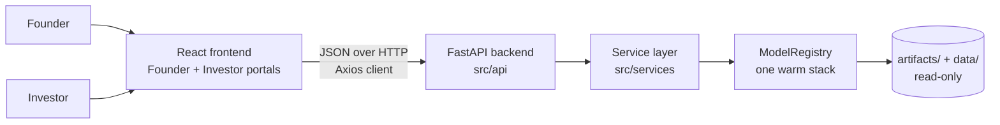

Two user roles share one analysis; the portals differ in framing. The backend is a single process that
loads everything once at startup. There is no database and no external service — no LLM, no third-party API.

---

## 2. The 13 layers

| # | Layer | Package | Input → output |
|---|---|---|---|
| 1 | Data & feature fusion | `src/preprocessing`, `src/features` | raw CSV → cleaned data → fused sparse+dense matrix |
| 2 | Venture knowledge base | `src/knowledge_base` | train campaigns → metadata table + text records |
| 3 | Venture intelligence engine | `src/retrieval` | records → SBERT embeddings → FAISS index → similar campaigns |
| 4 | Prediction engine | `src/models`, `src/training` | fused features → calibrated funding probability |
| 5 | Explainability | `src/explainability` | model + campaign → SHAP drivers, coefficients |
| 6 | Pattern mining | `src/pattern_mining` | train data → association rules, saved as artifacts; the item frame and `funding_patterns.json` feed layers 7 and 8 |
| 7 | Counterfactual engine | `src/counterfactual` | campaign → ranked single-feature changes with new probability |
| 8 | Objections, copilot, category analysis | `src/copilot` | signals → objections, SWOT, category trend |
| 9 | Evolution planner | `src/evolution` | probability + drivers → stage and milestone roadmap |
| 10 | Scenario simulator | `src/scenario` | campaign → ranked what-if scenarios |
| 11 | Recommendation & strategy | `src/recommendation` | layers 4–10 → priorities, founder/investor strategy, confidence |
| 12 | Multi-agent intelligence | `src/agents` | signals → six agent reports → committee verdict |
| 13 | Report generation | `src/reporting` | one bundle → founder / investor / memo / executive reports |

Around them: `src/api` + `src/services` (serving), `src/core` (registry, errors), `src/mlops` (tracking,
registry), `src/utils` (config, logging), `frontend/` (UI).

Layers build on one another by **composition, not by re-computation**: layer 13 holds layer 11 and 12,
layer 11 holds the aggregator, which holds 5, 8, 9, 10, which all share layer 8's counterfactual pipeline,
which holds the layer 4 model. One model object serves the whole stack.

---

## 3. Offline build pipeline

How the artifacts the server loads come to exist. Run once (notebooks 01–16); not part of serving.

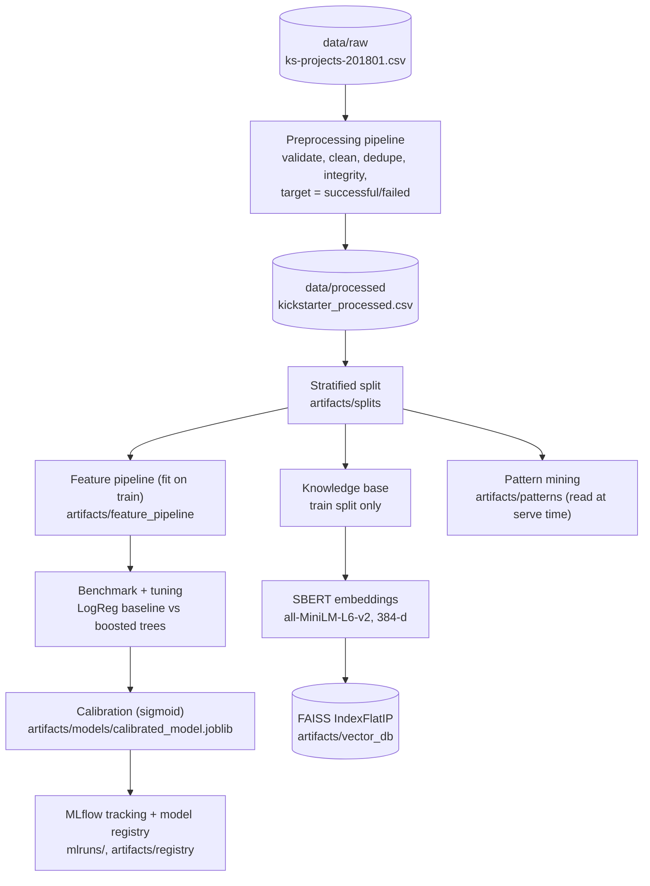

Two deliberate rules: the **feature pipeline is fit on train only** and applied unchanged afterwards, so
leakage is impossible by construction; the **knowledge base is built from the train split only**, so a
query campaign's own outcome is never in the index it searches.

---

## 4. Feature pipeline

One fit/transform object (`src/features/pipeline.py`) with a frozen order:

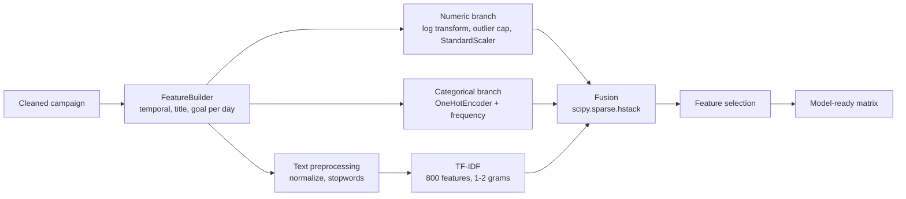

Row-preserving end to end, so a single future campaign goes through exactly the same path as training data.

---

## 5. Serving architecture

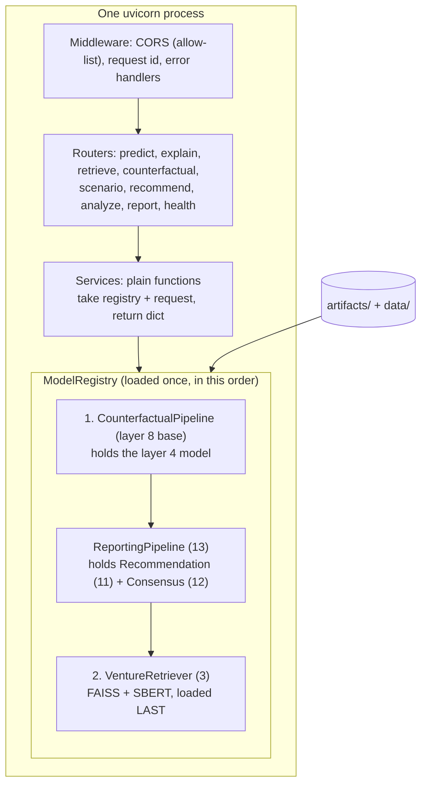

**Load order is a hard requirement.** The LightGBM stack loads first and FAISS/torch last, with
`OMP_NUM_THREADS=1` set before any heavy import (first lines of `src/api/main.py`). Reversed, the two
OpenMP runtimes conflict in one process.

### Route → service → registry handle

| Route | Service | Registry handle (layer) |
|---|---|---|
| `POST /predict` | `prediction_service` | `engine.predict` (4) |
| `POST /explain` | `explainability_service` | `explainer.explain_raw` (5) |
| `POST /retrieve` | `retrieval_service` | `retriever.retrieve` (3) |
| `POST /counterfactual` | `counterfactual_service` | `cf.analyze` (7) |
| `POST /scenario` | `scenario_service` | `scenario.run` (10) |
| `POST /recommend` | `recommendation_service` | `rec.run` (11) |
| `POST /analyze` | `pipeline_service` | `reporting` bundle + committee (12, 13) |
| `POST /report/founder` · `/investor` | `report_service` | `reporting.founder` / `.investor` (13) |
| `GET /health` · `/live` · `/ready` | `health` route | `registry.status()` / `ready()` |

Warm latencies measured in the Day-17 tests: `/predict` ≈ 12 ms, `/explain` ≈ 32 ms, `/retrieve` ≈ 16 ms,
`/recommend` ≈ 1.4 s, `/analyze` ≈ 3.9 s. The first `/retrieve` after start is slower (model warm-up).

---

## 6. Request lifecycle

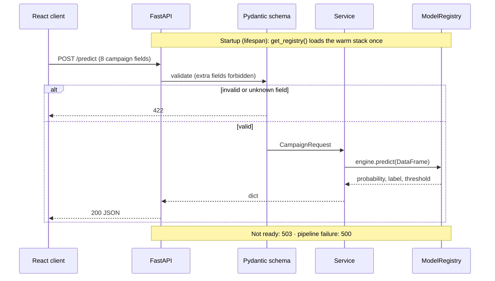

Error mapping (`src/core/exceptions.py`): invalid input → `422`; artifact or model unavailable → `503`;
pipeline failure → `500`; anything unexpected → `500` with a generic message and a logged traceback.

---

## 7. Prediction workflow

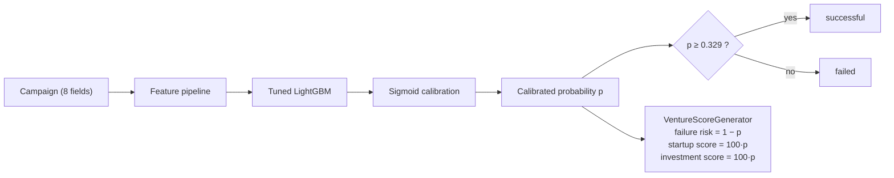

Every score in the product is a function of this one calibrated `p`. The other scores a dashboard might
show (Business-Model, Founder-Strength, …) are returned as `None` with a stated basis — see §11.

---

## 8. Retrieval pipeline

The only part of serving that uses FAISS and torch.

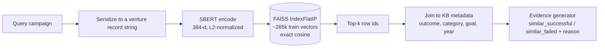

An **exact** flat index is used on purpose: at this size search is sub-millisecond, so approximate indexes
would only add recall loss. `/retrieve` is evidence for the founder; it does **not** feed the prediction.

---

## 9. Decision intelligence

`/recommend` and `/analyze` run on a **FAISS-free** stack. "Similar startups" inside this path is the
same-category cohort in a pandas frame, not semantic retrieval.

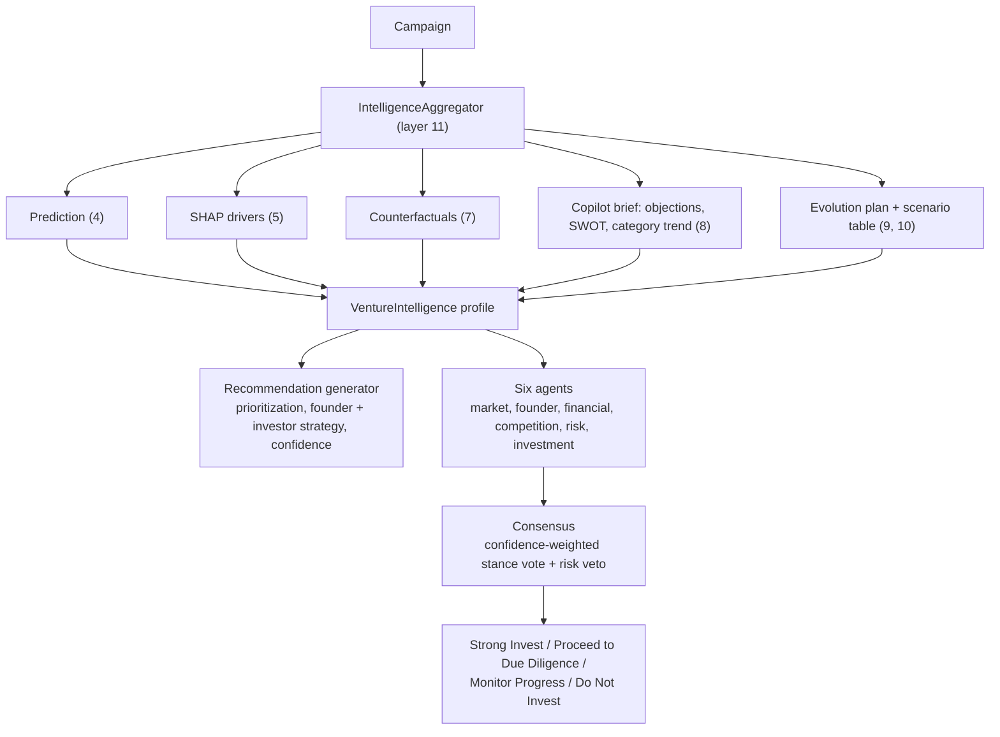

The aggregator is the **single collection point**: nothing is recomputed downstream. The committee is a
weighted vote, with a risk-agent veto and named dissent; its confidence is **not** inflated by the number
of agents, because they are correlated views of one signal set. Pattern mining (layer 6) is *mined
offline*, but its outputs are used live: the counterfactual engine reads `funding_patterns.json` for
category-typical goals, and the category analysis reads the pattern item frame. It has no endpoint of its
own and nothing re-mines at request time.

---

## 10. Report generation workflow

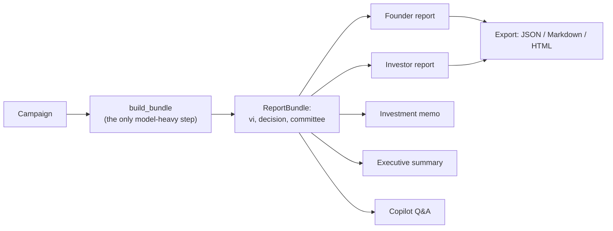

**Bundle once.** Every generator is a pure function of the bundle, so `/analyze` produces all four reports
and the copilot for the cost of one analysis. Each section carries a `source` (which layer produced it),
and a `deferred_appendix` lists what could not be computed. The frontend renders both. PDF is the
browser's print-to-PDF; there is no server-side PDF.

---

## 11. The honesty boundary

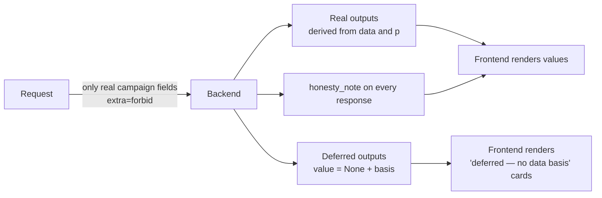

The data has no founder, team, revenue or market signals. So input outside the campaign schema is rejected
(`422`) and the dependent scores (and market size) are deferred rather than guessed. This is enforced at the schema, in
the score generator, and in the UI, so it cannot be bypassed by one layer's mistake.

---

## 12. Deployment architecture

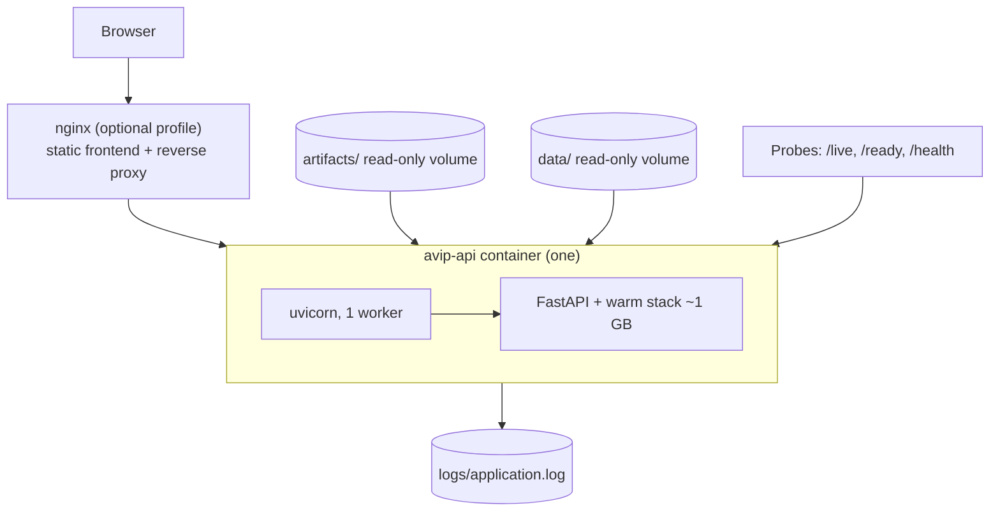

One container because the layers load as one warm stack and FAISS is an in-process library. Artifacts are
**mounted**, not baked in. Scale by adding containers, not workers. The Docker configuration is written
but **has not been built** (no Docker on the development machine). Details:
[DEPLOYMENT.md](DEPLOYMENT.md).

---

## 13. Folder structure

```text
AI-Venture-Intelligence-Platform/
├── src/
│   ├── preprocessing/ features/            layer 1
│   ├── knowledge_base/ retrieval/          layers 2–3
│   ├── models/ training/                   layer 4
│   ├── explainability/                     layer 5
│   ├── pattern_mining/                     layer 6
│   ├── counterfactual/                     layer 7
│   ├── copilot/                            layer 8
│   ├── evolution/ scenario/                layers 9–10
│   ├── recommendation/                     layer 11
│   ├── agents/                             layer 12
│   ├── reporting/                          layer 13
│   ├── api/ services/ core/                serving
│   ├── mlops/ utils/                       tracking, config, logging
├── frontend/          React + TypeScript app
├── tests/             95 tests (53 fast, 42 heavy)
├── notebooks/         01–20 executed verification notebooks (20 = release verification)
├── artifacts/         trained objects, indexes, reports (large files git-ignored)
├── data/              raw / interim / processed (git-ignored)
├── configs/  deployment/  scripts/  docs/  outputs/
├── Dockerfile  docker-compose.yml  requirements.txt  ruff.toml
└── README.md  LICENSE  CHANGELOG.md  CONTRIBUTING.md
```

---

## 14. Component interaction rules

1. **Routes never touch models.** Route → service → registry handle. Services are plain functions, so
   they are unit-testable without HTTP.
2. **Load once, load in order.** `get_registry()` is a process singleton; LightGBM stack before FAISS.
3. **Compose, don't recompute.** Higher layers hold lower ones; the aggregator is the one collection point.
4. **Fit on train, transform everywhere.** The feature pipeline and the knowledge base never see test data.
5. **Layers are deterministic.** Objections, agents and reports are rule-based over real signals.
6. **Honesty is structural.** Request schema, score generator, response notes and UI all enforce it.
7. **Artifacts are read-only at serving time.** Training writes them; the API only reads.

---

## 15. What the architecture does not include

- **Live pattern mining or a `/patterns` endpoint** — patterns are mined offline; serving only reads their outputs.
- **A startup catalog** — the product analyzes one submitted campaign; there is no multi-startup search or ranking.
- **Authentication** — the frontend has auth-ready structure (role state, protected routes) but no JWT.
- **A neural network** — never built; boosted trees were the model family benchmarked.
- **External data or an LLM** — everything is computed from the Kickstarter dataset.
- **A proven container image and full-suite CI** — Docker is configured but unbuilt; CI runs the fast lane only.
