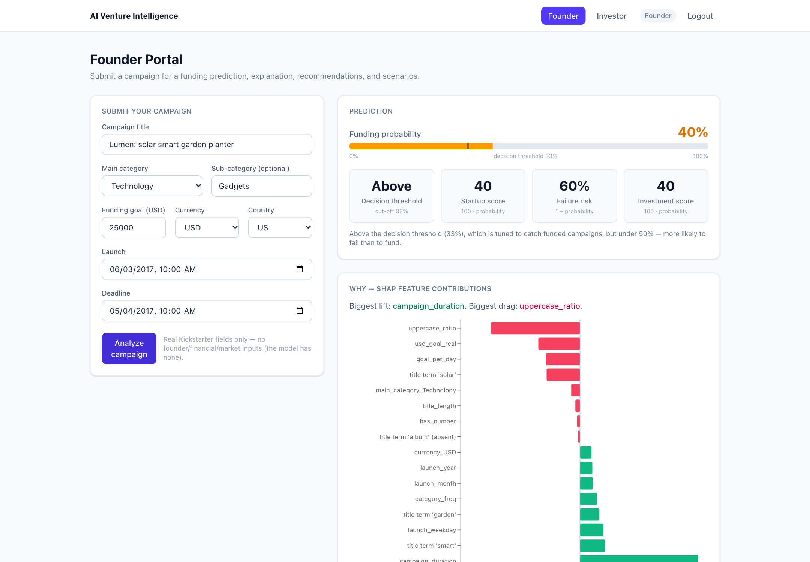
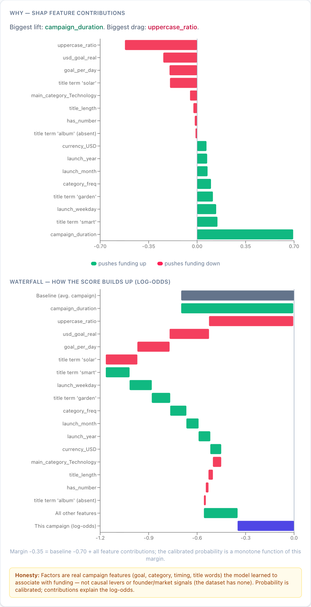
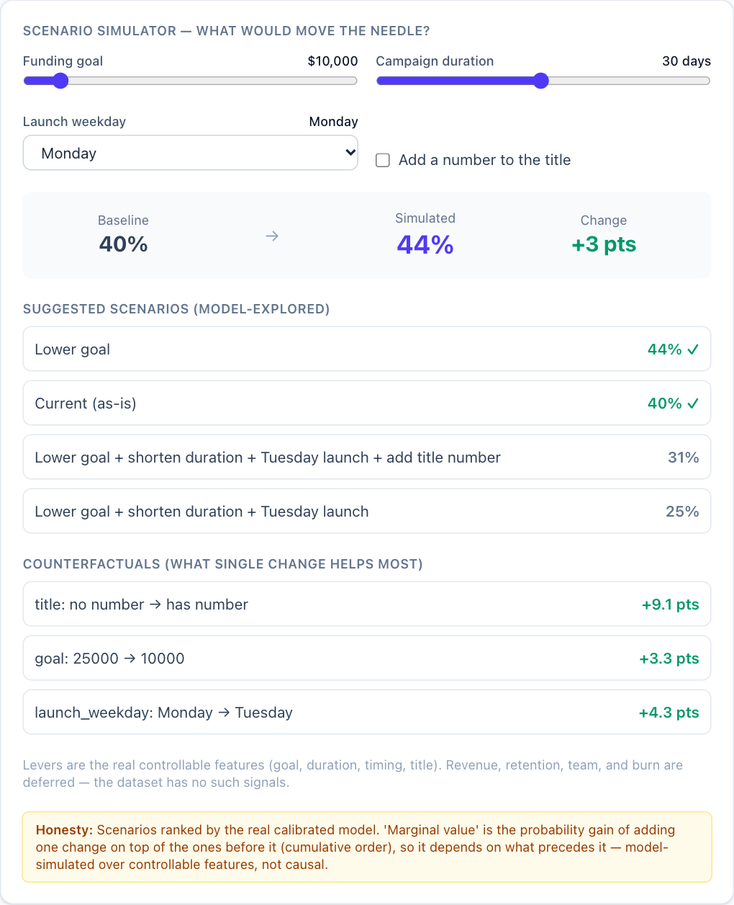
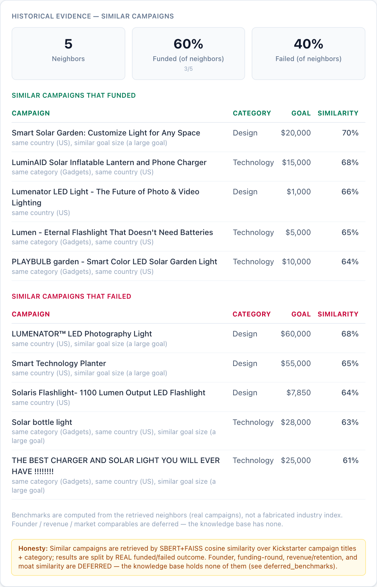
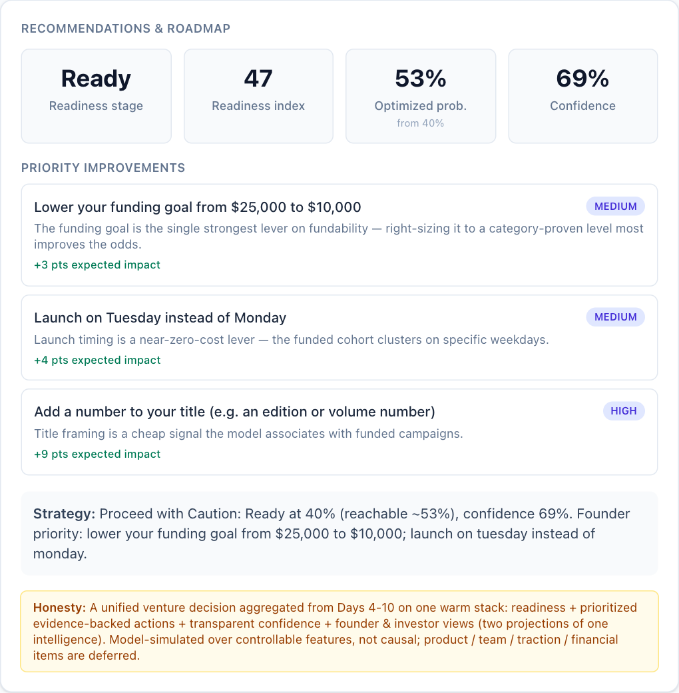
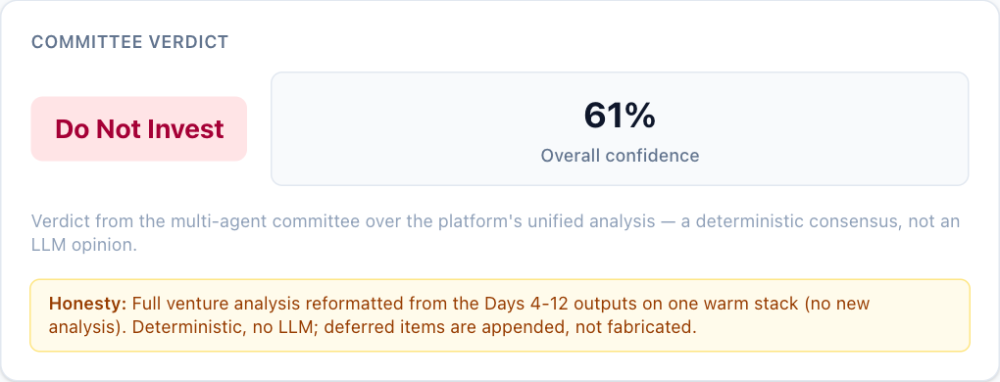

# Portfolio Assets

Everything here is generated from the real system — nothing is mocked up. Each group says how it was
made and how to regenerate it. Campaign **A** (*Lumen: solar smart garden planter*, a fictional campaign
dated inside the 2009–2017 training range) is the running example; see [DEMO_GUIDE.md](../DEMO_GUIDE.md).

| Folder / file | What | Regenerate |
|---|---|---|
| [`screenshots/`](screenshots/) | 19 screenshots of the running UI (desktop, mobile, API docs, exported reports) | `scripts/capture_screenshots.mjs` |
| [`diagrams/`](diagrams/) | the 11 architecture diagrams as PNG + SVG | render the Mermaid blocks in [SYSTEM_ARCHITECTURE.md](../SYSTEM_ARCHITECTURE.md) |
| [`charts/`](charts/) | model-evaluation and SHAP charts from the training artifacts | copied from `artifacts/evaluations/`, `artifacts/visualizations/` |
| [`sample_reports/`](sample_reports/) | the four reports for campaign A as HTML, Markdown and JSON | `ReportingPipeline.run(..., export=True)` |
| [`examples/`](examples/) | real API responses for campaign A (predict, explain, retrieve, counterfactual, scenario, recommend, copilot) | the live API |
| `campaign_A.json`, `_B`, `_D`, `demo_campaigns.json` | demo request bodies and captured results | [DEMO_GUIDE.md](../DEMO_GUIDE.md) |
| `openapi.json` | machine-readable API spec | `scripts/generate_api_docs.py` |
| `social-preview.png` | 1280×640 repository card (source: `social-preview.html`) | headless-Chrome screenshot of the HTML |

## Screenshots

Captured from the real app (Vite dev server + FastAPI backend) with headless Chrome, using
[`scripts/capture_screenshots.mjs`](../../scripts/capture_screenshots.mjs). The same run records any
browser console errors or failed requests — it saw none.

| | | |
|---|---|---|
|  |  |  |
| `02-founder-submitted` — form and prediction | `04-shap-bar-waterfall` — bar chart and waterfall | `05-scenario-simulator` — slider, scenarios, counterfactuals |
|  |  |  |
| `06-retrieval-tables` — similar funded / failed | `08-recommendations` — readiness and priorities | `10-investor-verdict` — committee verdict |

All files:

| File | Shows |
|---|---|
| `00-login.png` | role chooser (auth-ready stub) |
| `01-home.png` | landing page |
| `02-founder-submitted.png` | form beside the first result cards |
| `02b-founder-full-page.png` | the whole Founder page in one long image |
| `03-prediction.png` | probability bar, threshold marker, tiles and caption |
| `04-shap-bar-waterfall.png` | contribution bar chart and waterfall |
| `05-scenario-simulator.png` | goal slider at $10,000, suggested scenarios, counterfactuals |
| `06-retrieval-tables.png` | similar campaigns that funded and failed |
| `07-deferred-scores.png` | the six "deferred — no data basis" cards |
| `08-recommendations.png` | readiness, priority improvements, strategy |
| `09-founder-report.png` | the 8-section founder report with source badges |
| `10-investor-verdict.png` | committee verdict and confidence |
| `10b-investor-report.png` | the 10-section due-diligence report |
| `11-investor-risks.png` | Risks & Red Flags with the investor objections |
| `12-investor-committee-votes.png` | the six agents' votes |
| `13-api-docs.png` | Swagger UI at `/docs` |
| `15-mobile.png` | Founder page at 390 px wide |
| `16-exported-investor-report.png`, `17-exported-founder-report.png` | the standalone HTML exports (`sample_reports/`) |

## Diagrams

`diagrams/01-system-context` · `02-offline-build-pipeline` · `03-feature-pipeline` ·
`04-serving-architecture` · `05-request-lifecycle` · `06-prediction-workflow` · `07-retrieval-pipeline` ·
`08-decision-intelligence` · `09-report-generation` · `10-honesty-boundary` · `11-deployment-architecture`
(each as `.png` at 2× and vector `.svg`). Use the SVGs for slides and the PNGs for READMEs and posts.

## Charts

| File | Shows | Source numbers |
|---|---|---|
| `eval-precision_recall_curve.png`, `eval-roc_curve.png`, `eval-confusion_matrix.png` | held-out test performance | [PERFORMANCE_REPORT.md §3](../PERFORMANCE_REPORT.md#3-final-model-on-the-held-out-test-set) |
| `eval-calibration_curve.png`, `eval-calibration_curve_test.png` | reliability, validation and test | [§6](../PERFORMANCE_REPORT.md#6-calibration-and-the-decision-threshold) |
| `shap_summary.png`, `shap_importance.png`, `shap_waterfall.png` | global and local SHAP | [§5](../PERFORMANCE_REPORT.md#5-what-the-model-relies-on) |
| `coefficient_plot.png`, `tfidf_importance.png`, `tabular_importance.png` | Logistic-Regression coefficients, title-word and tabular importances | Day 5 reports |

## Honest notes for using these

- **Campaign A is fictional.** It is not in the Kickstarter dataset; say so if you show its numbers.
- **The model reflects 2009–2017.** Results for a campaign launched today are likely optimistic
  ([PERFORMANCE_REPORT.md §12](../PERFORMANCE_REPORT.md#12-weaknesses-and-limits)).
- **The screenshots show the development UI**, not a deployed site (Docker has not been built).
- Provenance badges inside the UI and reports use internal build labels such as "Day-12 committee".
- **Not captured:** a terminal screenshot of the `422` rejection, and a screen recording. Shot list and
  timeline: [DEMO_GUIDE.md §9](../DEMO_GUIDE.md#9-screenshot-and-recording-shot-list).
